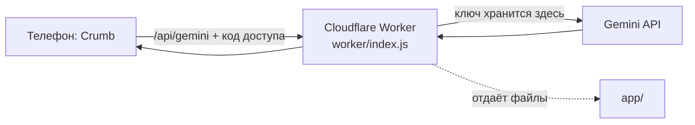

# Подключение Gemini: устройство

Пошаговая инструкция без оплаты: [SETUP-FREE.md](SETUP-FREE.md).

## Схема



Телефон никогда не обращается к Google напрямую и не хранит ключ. Поэтому пользователю не нужен VPN, а ключ нельзя вытащить из приложения.

## Модель

По [странице цен Gemini API](https://ai.google.dev/gemini-api/docs/pricing) (за 1 млн токенов, вход текст и изображение / выход, платный уровень):

| Модель | Вход | Выход | Заметка |
|---|---|---|---|
| `gemini-3.1-flash-lite` | $0.25 | $1.50 | По умолчанию: самая дешёвая стабильная из доступных новым ключам |
| `gemini-3.5-flash-lite` | $0.30 | $2.50 | Новее, сравниваем на тесте. Включается переменной `GEMINI_MODEL` |

Модели 2.5 в документации помечены как доступные только прежним пользователям. Идентификаторы и цены меняются, сверять перед релизом.

Оценка стоимости одного снимка на платном уровне: около 1 500 входных и 400 выходных токенов, то есть 0,1–0,15 цента. Это прикидка, не измерение. Пока работаем на бесплатном уровне, платить не нужно.

## Контракт сервера

`POST /api/gemini`, заголовок `x-crumb-pass: <APP_PASSCODE>`

```json
{ "system": "правила оценки или коуча", "messages": [{ "role": "user", "text": "..." }],
  "image": { "mime": "image/jpeg", "data": "<base64>" }, "json": true }
```

Ответ: `{ "text": "...", "model": "gemini-3.1-flash-lite" }`. Ошибки: `401 bad_pass`, `429 rate_limited`, `413 too_large`, `502 upstream` или `empty`, `500 no_key`.

`GET /api/health` отвечает `{ "ok": true, "ai": true }`, когда на сервере заданы и ключ, и код доступа. По этому ответу приложение понимает, что сервер подключён.

Сервер намеренно тонкий: правила оценки еды и промпт коуча лежат в `app/index.html` (`foodRules()`, `coachCtx()`), сервер только проверяет код и пересылает запрос в Gemini. Для пробной версии с одним пользователем этого достаточно. Перед открытием для посторонних правила переедут на сервер, иначе код доступа превращает прослойку в общий прокси к Gemini.

Запрос к Gemini (REST): `POST https://generativelanguage.googleapis.com/v1beta/models/<model>:generateContent`, заголовок `x-goog-api-key`, `responseMimeType = application/json` при `json: true`.

## Что дальше

1. Тест точности на 10–30 взвешенных блюдах, выбор модели.
2. Вход через Supabase (регион ЕС) и облачная синхронизация вместо хранения в браузере.
3. Лимит 3 бесплатных ИИ-фото в день на пользователя, платный уровень Gemini, правила оценки на сервере.
4. Настоящая PWA: офлайн-режим и свой домен.
