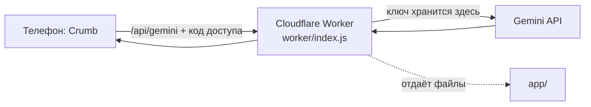

# Подключение Gemini: устройство

Пошаговая инструкция без оплаты: [SETUP-FREE.md](SETUP-FREE.md).

## Схема

Телефон никогда не обращается к Google напрямую и не хранит ключ. Поэтому пользователю не нужен VPN, а ключ нельзя вытащить из приложения.

## Модель

По [странице цен Gemini API](https://ai.google.dev/gemini-api/docs/pricing) (за 1 млн токенов, вход текст и изображение / выход, платный уровень):

| Модель | Вход | Выход | Заметка |
|---|---|---|---|
| `gemini-3.1-flash-lite` | $0.25 | $1.50 | По умолчанию: самая дешёвая стабильная из доступных новым ключам |
| `gemini-3.5-flash-lite` | $0.30 | $2.50 | Новее, сравниваем на тесте. Включается переменной `GEMINI_MODEL` |

Модели 2.5 в документации помечены как доступные только прежним пользователям. Идентификаторы и цены меняются, сверять перед релизом.

Оценка стоимости одного снимка на платном уровне: около 1 500 входных и 400 выходных токенов, то есть 0,1–0,15 цента. Это прикидка, не измерение. Пока работаем на бесплатном уровне, платить не нужно.

## Контракт сервера

Приложение отправляет серверу **задачу и данные**, а не текст для модели. Правила оценки еды и коуча хранятся только на сервере (`worker/core.js`: `FOOD_RULES`, `COACH_RULES`), поэтому чужие не могут использовать сервер как бесплатный чат.

`POST /api/ai`, заголовки: `x-crumb-id` (анонимный номер устройства), необязательно `x-crumb-pass` (личный код).

| Задача | Тело запроса | Ответ |
|---|---|---|
| `food` | `{task:"food", lang, diet?, text? \| image:{mime,data}+note? \| previous+fix}` | `{text}`: JSON с оценкой еды |
| `coach` | `{task:"coach", lang, ctx, messages:[{role,text}], stream:true}` | поток SSE от Gemini |
| `ping` | `{task:"ping", image?}` | `{text}`: проверка связи |

Ошибки: `401 bad_pass`, `429 limit_day | limit_ip | limit_global | rate_limited`, `413 too_large`, `400 bad_request`, `502 upstream | empty`, `504 timeout`, `500 no_key`.

`GET /api/health`: `{ok, ai, open, push, limit}`. `/api/state` (синхронизация) доступна только с личным кодом, `/api/push/*` (уведомления) всем.

`POST /api/gemini` (произвольный текст для модели) оставлен только для владельца и людей с личным кодом.

Запрос к Gemini (REST): `POST https://generativelanguage.googleapis.com/v1beta/models/<model>:generateContent` (или `streamGenerateContent?alt=sse`), заголовок `x-goog-api-key`, `responseMimeType = application/json` для задач с JSON.

## Что дальше

1. Тест точности на 10–30 взвешенных блюдах, выбор модели.
2. Вход через Supabase (регион ЕС) и облачная синхронизация вместо хранения в браузере.
3. Платный уровень Gemini перед широким запуском (на бесплатном Google может использовать данные).
4. Настоящая PWA: офлайн-режим и свой домен.
